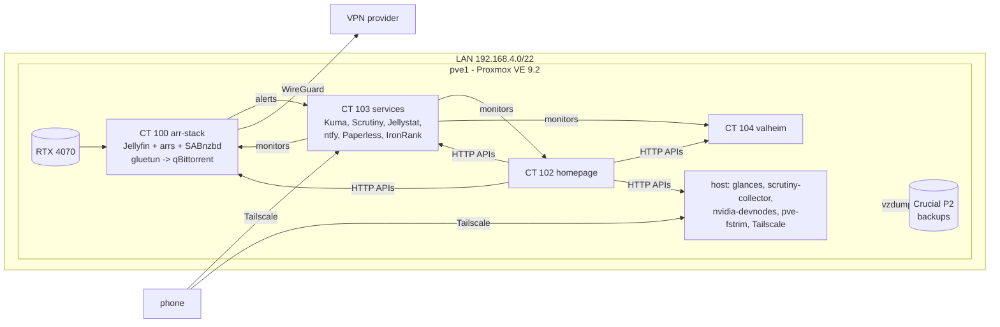

# Overview

`pve1` is a single Proxmox VE node. Everything runs in unprivileged LXC
containers with Docker Compose inside, and each concern gets its own container
so that maintenance on one (e.g. updating the media stack) never takes down
the dashboard or monitoring.

## Design choices

- **LXC over VMs.** Lower overhead, and the GPU can be shared into a container
  without dedicating it via PCI passthrough.
- **One stack per container.** CT 102 (dashboard) and CT 103 (monitoring) stay
  up while CT 100 is being updated or debugged.
- **No reverse proxy or local DNS.** Services are reached by `IP:port` on the
  LAN and over Tailscale from outside. Nothing is exposed to the internet.
- **Secrets in `.env` files only.** Compose files and dashboard YAML reference
  variables; `.env` is `root:600` and never committed.

## Index

1. [Hardware and storage](01_hardware-and-storage.md)
2. [Network and remote access](02_network-and-access.md)
3. [Guests](03_guests.md)
4. [GPU passthrough](04_gpu-passthrough.md)
5. [Monitoring and alerts](05_monitoring-and-alerts.md)
6. [Backup and recovery](06_backup-and-recovery.md)
7. [Roadmap](07_roadmap.md)
